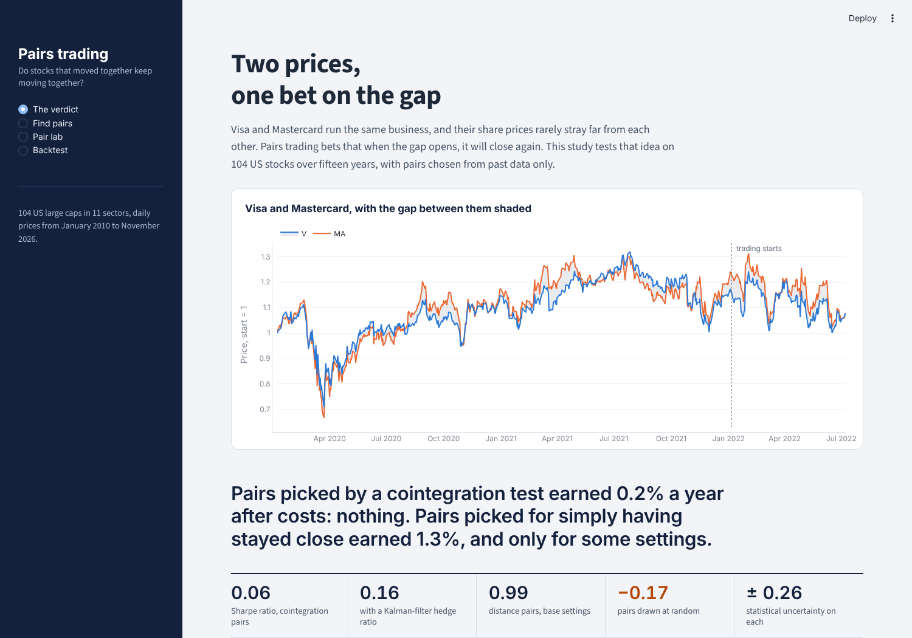
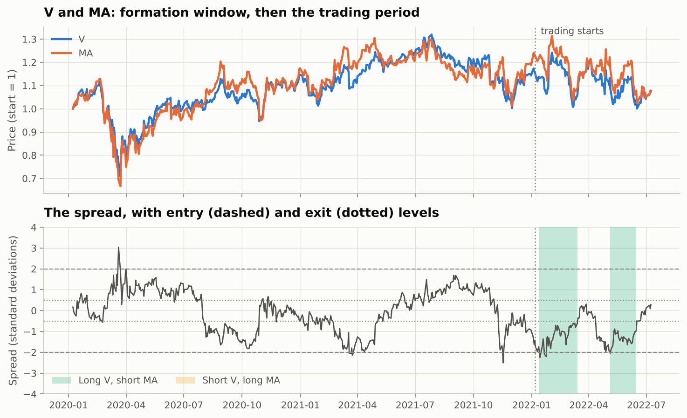
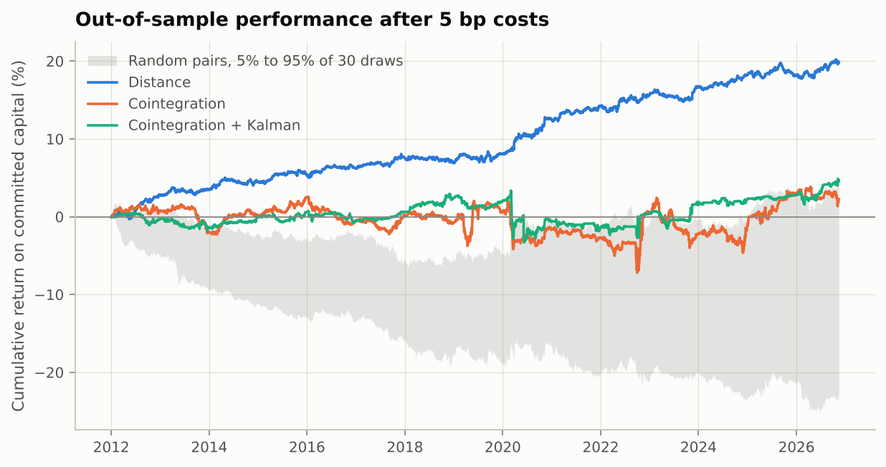
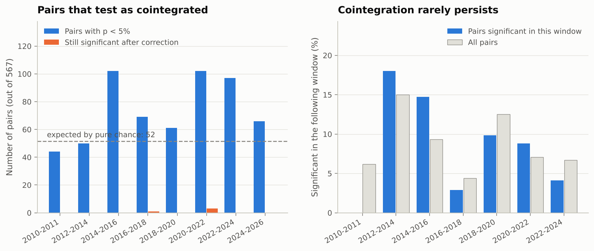
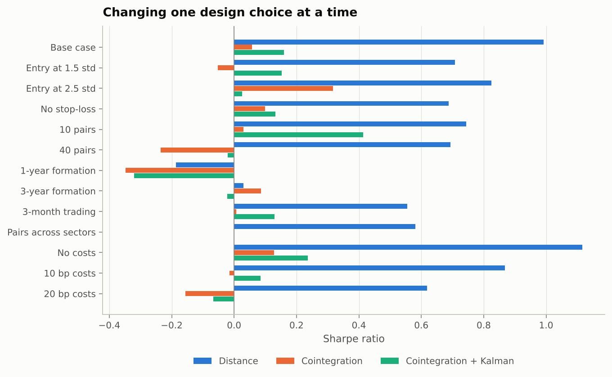
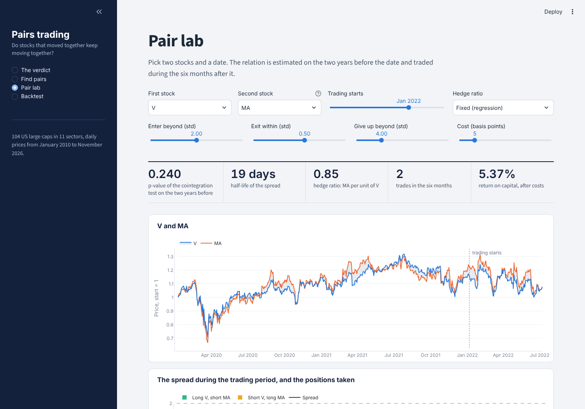

# Pairs Trading

Do stocks that moved together keep moving together? A walk-forward test of pairs trading on 104 US stocks over fifteen years, with the result reported as it came out: **pairs selected by a cointegration test earned nothing after costs**, and the study shows why.



## The idea

Visa and Mastercard run the same business, and their share prices rarely stray far from each other. Pairs trading bets that when the gap between two such stocks opens, it will close again: buy the one that fell behind, sell the other, and wait.



Three questions decide whether this works: how to find pairs that are really tied together, how to trade them, and whether the profit survives costs and an honest test.

## Results

Design: every six months, 20 pairs are selected using the two previous years only, then traded for six months with frozen parameters, at a cost of 5 basis points per trade. 30 periods, January 2012 to November 2026. These settings were fixed before looking at any result.

| Pair selection | Return per year | Volatility | Sharpe ratio | Max drawdown |
|---|---|---|---|---|
| Cointegration test | 0.15% | 2.7% | 0.06 ± 0.26 | -9.5% |
| Cointegration test, Kalman-filter hedge ratio | 0.32% | 2.0% | 0.16 ± 0.26 | -6.5% |
| Closest prices (distance method) | 1.33% | 1.3% | 0.99 ± 0.32 | -2.0% |
| Random same-sector pairs (mean of 30 draws) | -0.69% | 3.0% | -0.24 ± 0.21 | -16.3% |

Returns are on committed capital, without leverage. The ± is one standard error.



### 1. Cointegration-selected pairs earned nothing

A Sharpe ratio of 0.06 with a standard error of 0.26 is zero. Updating the hedge ratio with a Kalman filter does not change the conclusion. The strategy does better than random pairs, which lose the transaction costs, but not by a margin that can be told from luck.

### 2. The reason: the test finds coincidences

Each two-year window tests 567 pairs of stocks from the same sector.

- Between 44 and 102 pairs pass the test at the 5% level. About 52 would pass **by chance alone** (measured on simulated unrelated random walks).
- After correcting for the number of tests (Benjamini-Hochberg), between 0 and 3 pairs remain.
- Of the pairs that pass in one window, **9% pass again in the next. For all pairs, the figure is also 9%.** The ranking of pairs by test statistic in one window has no relation to the ranking in the next (rank correlation -0.01).

In-sample cointegration, on this universe and with two years of data, carries no information about the future.



### 3. The simpler distance method did better, but not robustly

Choosing the pairs whose prices simply stayed closest, and trading them one for one, gives a Sharpe ratio near 1. Changing one design choice at a time:



The result survives changes to the entry level, the stop, the number of pairs and the costs (Sharpe ratio 0.6 to 1.1). It disappears when the formation window is one year (-0.19) or three years (0.03) instead of two. With no reason to prefer two years, and after trying three selection methods, one good configuration is roughly what chance would produce. The fair reading is "possibly a small effect, not established".

Even taken at face value, 1.3% a year with 1.3% volatility is only attractive with leverage, whose costs (financing, borrowing shares to short) are not in this backtest.

### 4. What a look-ahead bug would have shown

Standardising the spread with the mean and standard deviation of the period being traded, instead of the formation period, is a classic mistake. On the same pairs, with the same rule and costs:

| Signal scaled with | Return per pair, annualised | Profitable pair-periods |
|---|---|---|
| The formation period (correct) | -0.7% | 34% |
| The period being traded (look-ahead) | +10.1% | 70% |

Two numbers taken from the future turn a losing strategy into an apparently excellent one. The test suite therefore checks that rewriting future prices never changes an earlier position or return.

## Dashboard

```bash
streamlit run app/streamlit_app.py
```

Four sections, with interactive charts:

- **The verdict**: the result in one page.
- **Find pairs**: the cointegration scan window by window, against what chance produces, and whether the pairs found persist.
- **Pair lab**: any two stocks, any date: prices, spread, positions, hedge ratio and profit, with every threshold adjustable.
- **Backtest**: change the selection method, the windows, the number of pairs, the thresholds and the costs, and see whether a result survives.



## Installation

```bash
git clone https://github.com/AminD/pairs-trading-reference.git
cd pairs-trading-reference
python -m venv .venv
.venv\Scripts\activate          # Windows
# source .venv/bin/activate     # macOS / Linux
pip install -r requirements.txt
```

## Usage

```python
import numpy as np
from pairs import (load_prices, split_benchmark, engle_granger, scan_pairs, candidate_pairs,
                   trade_pair, run_backtest, Settings, Rule, metrics)

prices, benchmark = split_benchmark(load_prices("data/prices.csv"))

# Test one pair
window = prices.loc["2020":"2021"]
test = engle_granger(np.log(window["V"].to_numpy()), np.log(window["MA"].to_numpy()))
test.p_value, test.beta, test.half_life

# Test every same-sector pair
scan = scan_pairs(np.log(window), candidate_pairs(prices.columns))

# Trade one pair: calibrate on the first frame, trade the second
trade = trade_pair(prices[["V", "MA"]].loc["2020":"2021"], prices[["V", "MA"]].loc["2022-01":"2022-06"],
                   method="kalman", rule=Rule(entry=2.0, exit=0.5, stop=4.0), cost_bps=5)
trade.returns, trade.position, trade.hedge_ratio

# Walk-forward backtest of a portfolio of pairs
result = run_backtest(prices, Settings(selection="cointegration", n_pairs=20, cost_bps=5))
metrics.sharpe_ratio(result.returns), result.pairs
```

```bash
python scripts/make_figures.py   # figures and tables of this README (about 4 minutes)
pytest                           # 43 tests
```

## Project structure

```
pairs/
  data.py            prices, sectors, candidate pairs, simulated pairs
  cointegration.py   Engle-Granger test, half-life, pair scan, Benjamini-Hochberg
  kalman.py          Kalman filter for a time-varying hedge ratio
  strategy.py        trading rule, pair returns and costs
  backtest.py        walk-forward backtest with three selection methods
  metrics.py         return, volatility, Sharpe ratio and its standard error, drawdown
  plotting.py        chart styles
app/streamlit_app.py   interactive dashboard
notebooks/             three notebooks with the full analysis
scripts/               figures, data download
tests/                 test suite
data/prices.csv        daily adjusted prices, 104 stocks, 2010-2026
docs/theory.md         mathematical background
docs/results/          result tables behind the figures
```

## Notebooks

1. [Cointegration](notebooks/01_cointegration.ipynb): correlation against cointegration, the Engle-Granger test, multiple testing, persistence.
2. [Trading a pair](notebooks/02_trading_a_pair.ipynb): the rule, the cost of a look-ahead bug, fixed against Kalman-filter hedge ratios.
3. [Backtest](notebooks/03_backtest.ipynb): the three selection methods, the placebo, robustness and costs.

## How the code is validated

- The Engle-Granger and ADF statistics match statsmodels to eight digits.
- On simulated cointegrated pairs the test recovers the true hedge ratio and half-life; on unrelated random walks it rejects about 5% of the time.
- The Kalman filter reproduces ordinary least squares when the states are constant, and its forecast errors are correctly scaled.
- The trading rule and the return accounting are checked against hand calculations.
- **No look-ahead**: for single pairs and for the whole backtest, altering future prices leaves every earlier position and return unchanged.
- On a simulated market containing real pairs, the selection finds them and the backtest is profitable: the code can detect an effect when there is one.

## Limits

- **Universe.** Companies that are large today with a full history since 2010. Pairs that broke because one company failed or was acquired are absent, which flatters every strategy somewhat.
- **Data.** Daily closing prices from Yahoo Finance; positions are assumed to trade at the close. One known error (Danaher's 2016 spin-off) is corrected in `pairs/data.py`.
- **Costs.** A flat 5 basis points per trade; no financing or share-borrowing costs, no market impact.
- **Tests.** Engle-Granger with one lag, in both directions, on pairs only. Johansen tests and baskets of more than two stocks are not covered.
- **Scope.** One market, fifteen years, large caps. Pairs trading profits are known to have declined in US large caps (Do and Faff, 2010); less liquid markets or intraday horizons may behave differently.

## References

- R. Engle and C. Granger, "Co-integration and Error Correction: Representation, Estimation, and Testing", *Econometrica*, 1987.
- E. Gatev, W. Goetzmann and K. G. Rouwenhorst, "Pairs Trading: Performance of a Relative-Value Arbitrage Rule", *Review of Financial Studies*, 2006.
- B. Do and R. Faff, "Does Simple Pairs Trading Still Work?", *Financial Analysts Journal*, 2010.
- J. MacKinnon, "Critical Values for Cointegration Tests", 1991, revised 2010.
- Y. Benjamini and Y. Hochberg, "Controlling the False Discovery Rate", *Journal of the Royal Statistical Society B*, 1995.
- E. Chan, *Algorithmic Trading: Winning Strategies and Their Rationale*, 2013.
- A. Lo, "The Statistics of Sharpe Ratios", *Financial Analysts Journal*, 2002.
